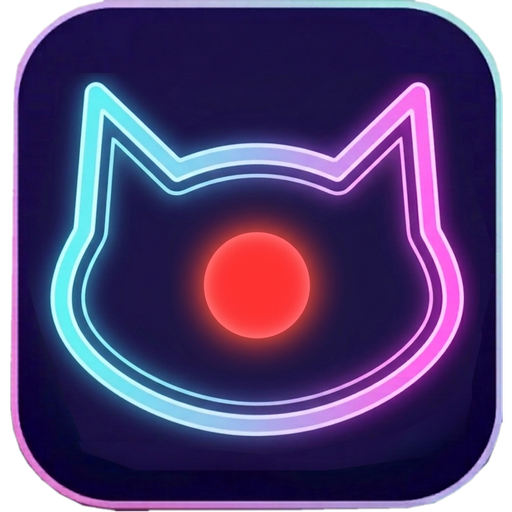
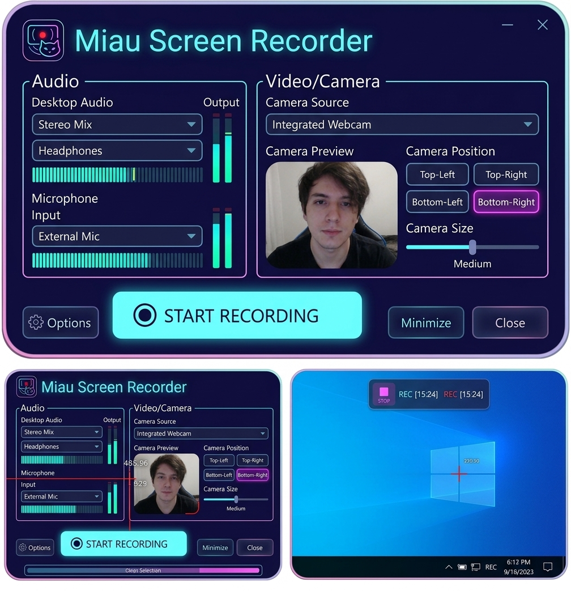

<p align="center"></p>

# Miau Screen Recorder

Grabador de pantalla **ligero** para Windows 10/11, escrito en C++20.
Graba el audio del escritorio y del micrófono, y muestra tu cámara en la esquina que quieras
(como en un streaming).



## Qué hace

- **Selector de área** al pulsar *START RECORDING* (como la herramienta de recortes de Windows).
  `F` = pantalla completa, `Esc` o clic derecho = cancelar.
- **Audio del escritorio** (WASAPI loopback) con selección del dispositivo de salida.
- **Micrófono** con selección del dispositivo de entrada. Medidores de nivel en vivo para ambos.
- **Cámara** (Media Foundation): al abrir el programa elige sola una cámara disponible (evita las virtuales como OBS) y
  puedes cambiarla o desactivarla. Vista previa y **barra de volumen del micrófono** bajo la imagen.
- **Cámara y botón STOP arrastrables** a cualquier lugar de la pantalla **mientras grabas** (cursor de cruz en todo el cuadro):
  - La cámara empieza abajo a la derecha. Se arrastra con el mouse desde cualquier punto.
  - Al pasar el cursor sobre ella aparecen **4 círculos en las esquinas** (no salen en el video): arrástralos para
    **agrandarla o reducirla de forma proporcional**. El último tamaño se recuerda para la próxima grabación.
  - Sobre la cámara hay un botón de **3 puntitos** (no sale en el video): *Hide camera* la oculta para grabar solo la pantalla.
    Queda un botón flotante transparente de 3 puntitos, también arrastrable, con *Show camera* para volver a mostrarla.
  - El botón STOP (con el tiempo `REC 00:00`) se arrastra desde cualquier punto; un clic sin mover sobre el cuadrado STOP
    detiene la grabación. Tampoco aparece en el video (`WDA_EXCLUDEFROMCAPTURE`, Windows 10 versión 2004 o superior).
- Codificación H.264 por hardware (NVENC / Quick Sync / AMF / Media Foundation) y AAC con las
  bibliotecas de FFmpeg. Guarda en MKV y lo convierte a MP4 al terminar (así no se pierde nada si
  la app se cierra de golpe). Opción de pistas de audio separadas.
- Ajustes guardados en `%APPDATA%\MiauScreenRecorder\settings.ini`.

## Compilar

El proyecto usa **MinGW-w64** y produce **un solo `.exe`** (FFmpeg 9.0 va incluido de forma estática en
`third_party/ffmpeg`; Dear ImGui lo descarga CMake solo).

**En Windows (MSYS2, terminal UCRT64):**

```bash
pacman -S --needed mingw-w64-ucrt-x86_64-gcc mingw-w64-ucrt-x86_64-cmake mingw-w64-ucrt-x86_64-ninja git
cmake -S . -B build -G Ninja
cmake --build build
```

**Desde Linux (compilación cruzada):**

```bash
sudo apt install g++-mingw-w64-x86-64 cmake ninja-build git
cmake -S . -B build -G Ninja -DCMAKE_TOOLCHAIN_FILE=cmake/mingw-w64-x86_64-linux.cmake
cmake --build build
```

El resultado es `build/Miau Screen Recorder.exe` (~4 MB, sin DLL externas).

## Estructura

| Archivo | Qué contiene |
| --- | --- |
| `src/main.cpp` | Ventana, Direct3D 11, interfaz ImGui y flujo de la app |
| `src/audio.*` | Lista de dispositivos y captura WASAPI (medidores + grabación) |
| `src/camera.*` | Lista de cámaras y lectura con Media Foundation |
| `src/region_selector.*` | Capa a pantalla completa para elegir el área |
| `src/overlays.*` | Cámara flotante y botón STOP arrastrables |
| `src/screen_capture.*` | Captura de pantalla (DXGI Desktop Duplication) |
| `src/encoder.*`, `src/recorder.*` | Codificación con FFmpeg y coordinación de la grabación |
| `third_party/ffmpeg` | FFmpeg 9.0 estático (LGPL) y cómo se compiló |
| `scripts/build-ffmpeg-static.sh` | Recrea esa build de FFmpeg |
| `src/settings.*` | Ajustes persistentes |

## Qué no sale en el video

Los tres puntos, los círculos de las esquinas, el menú y la barra de volumen bajo la cámara son ventanas
excluidas de la captura (`WDA_EXCLUDEFROMCAPTURE`, Windows 10 2004 o superior): solo las ves tú.
Si algo apareciera en el video, revisa `%APPDATA%\MiauScreenRecorder\log.txt`: ahí queda registrado
si Windows aceptó la exclusión de cada ventana y qué resolución/formato de cámara se eligió.

## Limitaciones conocidas

- El área se recorta al monitor que más la contiene (no une varios monitores en un mismo video).
- Las ventanas protegidas contra captura (DRM) salen en negro, igual que en otros grabadores.
- La interfaz no se reescala si cambias la ventana a un monitor con otro DPI mientras está abierta.

## Apoyo

Si te gusta Miau Screen Recorder puedes invitarme un café en https://ko-fi.com/miauapps (botón «About» dentro de la app).

## Licencia

MIT (ver `LICENSE`). Licencias de terceros en `THIRD_PARTY_NOTICES.md`.

> Eres responsable de respetar las leyes de privacidad y de pedir consentimiento antes de grabar
> pantallas, cámaras o audio de otras personas.
